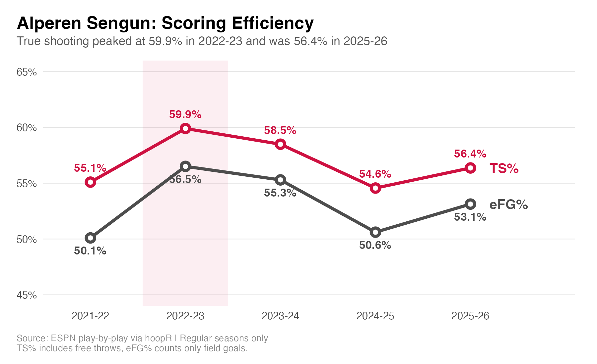
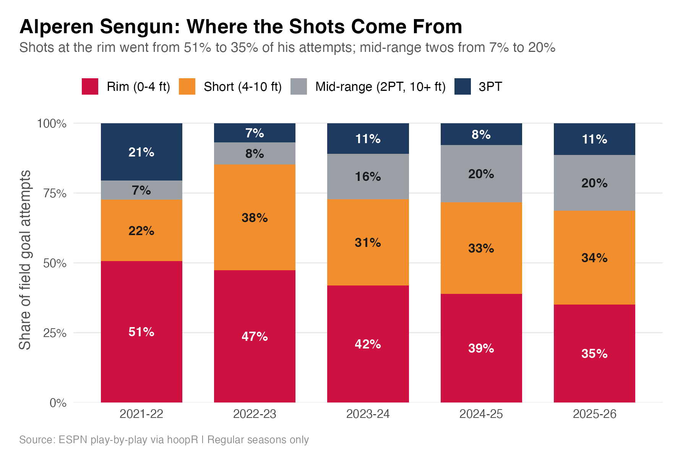
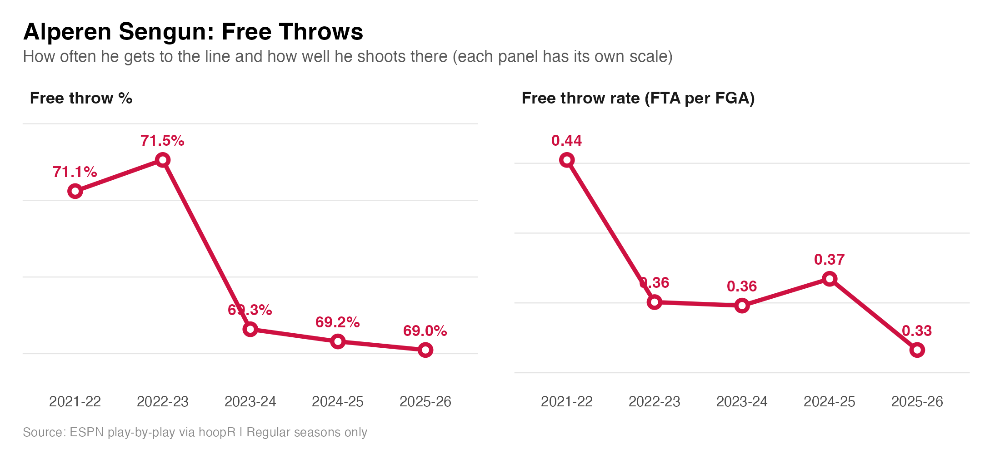
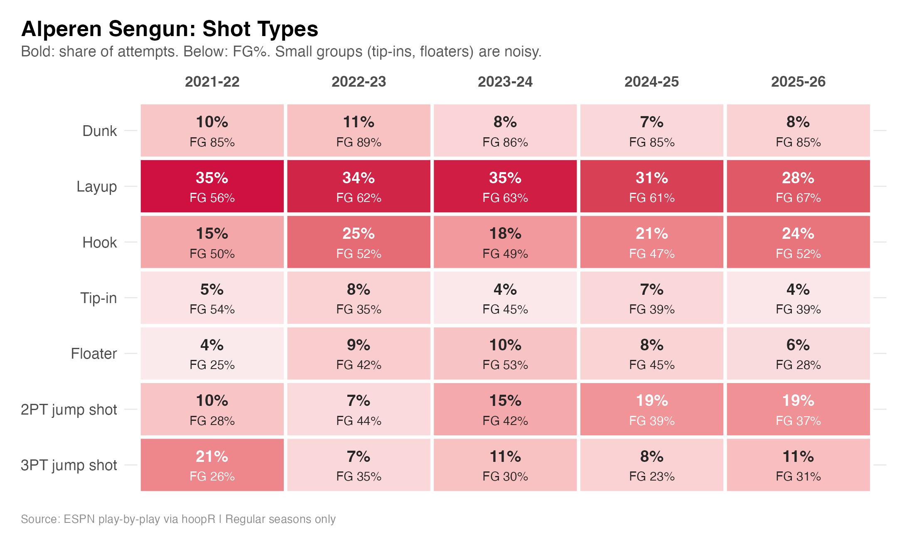

# Alperen Şengün: A Descriptive Shooting Profile (2021-22 to 2025-26)

Season-by-season scoring efficiency, shot distribution, free throws and shot types for Alperen Şengün (Houston Rockets), computed from raw ESPN play-by-play data in R.

## Key findings
- **Efficiency peaked early.** TS% was highest in 2022-23 (59.9%), dropped to 54.6% in 2024-25 and recovered to 56.4% in 2025-26.
- **Shot selection moved away from the rim.** Rim attempts fell from 51% to 35% of his shots, while mid-range twos grew from 7% to about 20%.
- **He gets to the line often but shoots about 70% there.** Free throw rate has been between 0.33 and 0.44, FT% between 69% and 72%.
- **Layups improved, jump shots did not.** Layup FG% rose from 56% to 67%; 2PT jump shot FG% has been between 37% and 44% since his rookie season.

## Project history
- **December 2025: first version.** I built a league-wide analysis of 2024-25 NBA shots as an undergraduate Big Data Analysis course project at Çanakkale Onsekiz Mart University. It used logistic regression on `hoopR` play-by-play data to study how shot distance, shot type, clutch situations and time left relate to whether a shot goes in.
- **Revisiting it.** When I went back to revise that project, I found problems in the data preparation: shot distance was measured to only one of the two hoops, and free throws were mixed in with field goal attempts. Both distorted parts of the results (for example, the apparent clutch effect).
- **This project.** I decided to focus on a single player, Alperen Şengün, and rebuilt the pipeline with those problems fixed. The original course project is not part of this repository.

## Questions
For each of Şengün's five NBA regular seasons:
1. How efficient is his scoring (TS% and eFG%)?
2. Where do his shots come from (distribution by zone)?
3. How often does he get to the free throw line, and how well does he shoot there?
4. What types of shots does he take, and how often do they go in?

This is a descriptive analysis. It does not explain *why* the numbers change.

## Data
- ESPN play-by-play data via `hoopR::load_nba_pbp()`, regular seasons 2021-22 to 2025-26
- Playoffs and play-in games are excluded
- Unit of analysis: one shot (field goal or free throw attempt) taken by Şengün
- Each season is loaded one at a time and reduced to his shooting plays

## Definitions
| Metric | Definition |
|---|---|
| eFG% | (FGM + 0.5 × 3PM) / FGA |
| TS% | PTS / (2 × (FGA + 0.44 × FTA)) |
| Free throw rate | FTA / FGA |
| Zones | Rim (0-4 ft), Short (4-10 ft), Mid-range (2PT, 10+ ft), 3PT |
| Shot types | Grouped from ESPN's shot labels: Dunk, Layup, Hook, Tip-in, Floater, 2PT jump shot, 3PT jump shot |

Shot distance is measured to the hoop the shot was aimed at (hoop centers at x = ±41.75 ft). The shot-type groups and zone cutoffs are my own choices.

Three-point attempts are identified from the play description (the text contains "three point"); ESPN does not provide a separate shot-value field for missed shots.

eFG%: Effective Field Goal Percentage
FGA: Field Goal Attempts
FGM: Field Goals Made
TS%: True Shooting Percentage
FTR: Free Throw Rate
FTA: Free Throw Attempts

## Results

### Scoring efficiency
| Season | Games | FGA | FTA | PTS | eFG% | TS% |
|---|---|---|---|---|---|---|
| 2021-22 | 72 | 525 | 232 | 691 | 50.1% | 55.1% |
| 2022-23 | 75 | 799 | 288 | 1,109 | 56.5% | 59.9% |
| 2023-24 | 63 | 982 | 352 | 1,330 | 55.3% | 58.5% |
| 2024-25 | 77 | 1,145 | 428 | 1,455 | 50.6% | 54.6% |
| 2025-26 | 72 | 1,135 | 378 | 1,467 | 53.1% | 56.4% |

TS% peaked in 2022-23 (59.9%), fell to 54.6% in 2024-25 and recovered partly in 2025-26 (56.4%). His shot volume more than doubled from 525 attempts in the first season to over 1,100 in the last two. The data cannot separate the effects of role, teammates and shot difficulty.

### Shot distribution

| Season | Rim (0-4 ft) | Short (4-10 ft) | Mid-range (2PT, 10+ ft) | 3PT |
|---|---|---|---|---|
| 2021-22 | 50.7% | 21.9% | 6.9% | 20.6% |
| 2022-23 | 47.3% | 37.9% | 7.9% | 6.9% |
| 2023-24 | 42.0% | 30.9% | 16.3% | 10.9% |
| 2024-25 | 38.9% | 32.8% | 20.4% | 7.9% |
| 2025-26 | 35.1% | 33.6% | 20.0% | 11.4% |

The share of shots at the rim fell every season, from about half to about a third, while the share of mid-range twos rose from 7% to around 20%. Three-pointers made up 21% of his attempts as a rookie and 7-11% since.

### Free throws

| Season | FTA | FTM | Free throw rate | FT% |
|---|---|---|---|---|
| 2021-22 | 232 | 165 | 0.44 | 71.1% |
| 2022-23 | 288 | 206 | 0.36 | 71.5% |
| 2023-24 | 352 | 244 | 0.36 | 69.3% |
| 2024-25 | 428 | 296 | 0.37 | 69.2% |
| 2025-26 | 378 | 261 | 0.33 | 69.0% |

His free throw percentage has stayed between 69% and 72%. His free throw rate was highest as a rookie (0.44) and has been between 0.33 and 0.37 since.

### Shot types

- **Layups:** the most common shot type (28-35% of attempts). FG% rose from 56% in 2021-22 to 67% in 2025-26, while their share fell from 35% to 28%.
- **2PT jump shots:** their share grew from 10% to 19%, with FG% between 28% and 44% (28% on 54 attempts in 2021-22, 37% on 214 in 2025-26).
- **Hooks:** 15-25% of attempts, FG% between 47% and 52%.
- **Dunks:** 7-11% of attempts, FG% between 85% and 89%.
- **3PT jump shots:** FG% between 23% and 35% on 55-129 attempts per season.

Tip-ins and floaters have only 20-103 attempts per season, so their FG% is noisy.

## Validation
For 2023-24, the TS% (58.5%) and points per game (1,330 points in 63 games, 21.1) computed here match the figures listed on [StatMuse](https://statmuse.com/nba/player/alperen-sengun-10297).

## Limitations
- Regular seasons only; no playoff analysis
- No minutes, possessions, defender or lineup information, so the numbers describe what he did, not how hard or how well-defended the shots were
- Shot-type groups depend on ESPN's labels, and small groups have wide uncertainty
- ESPN play-by-play data can differ slightly from official box scores and may be revised, so figures could shift a little over time
- Descriptive only: the analysis does not explain causes

## Files
- `sengun_profile.R`: the full analysis script
- `sengun_season_summary.csv`: season-level summary table
- `sengun_efficiency.png`, `sengun_distribution.png`, `sengun_free_throws.png`, `sengun_shot_types.png`: plots produced by the script

## Data and acknowledgments
Play-by-play data from ESPN, accessed through the [`hoopR`](https://hoopr.sportsdataverse.org/) package from the SportsDataverse.
Data retrieved: November 2026.